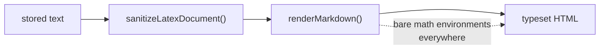

# LaTeX documents in stored runs

Stored prompts are frequently a pasted LaTeX *document* rather than prose: bare `\begin{eqnarray}...\end{eqnarray}` blocks with no `$` delimiters, section and cross-reference commands, `%` comments, and — when the text came out of a PDF — command names whose backslashes were doubled. None of that is Markdown, so it used to print as literal source. This note records how it is handled and, more importantly, where each rule is allowed to apply.

## What the real data contained

Every rule below exists because it was measured against the runs in `council.duckdb` first, not designed in the abstract:

| Construct | Where it occurred |
|---|---|
| Bare environments | 3 of 16 stored prompts (`eqnarray` 35, `equation` 15, `array` 4, `thm` 3, `figure` 2 across prompts and synthesis) |
| Doubled backslashes | Both prompts (mixed: 582 doubled commands against 315 correct ones) and synthesis (one run with every run of backslashes exactly length 2) |
| `%` comments | 15 whole-line comments, plus `\label{semi}%\begin{array}` — a comment hiding a whole environment |
| Literal percents | 19 mid-line cases in synthesis (`~10–20% because`, `50–80%.`) |
| `\label` / `\ref` / `\centering` / `\bigskip` | Inside `equation` and `eqnarray` bodies |

The last two rows are why two rules are narrower than they first appear.

## Two pieces, deliberately separate



- `renderMarkdown()` typesets bare math environments wherever it meets them. That is a *content* concern, and it applies to member answers and synthesis as well as prompts, so it lives in the renderer itself.
- `sanitizeLatexDocument()`, composed by `renderLatexDocument()`, rewrites document-level LaTeX: comments, equation numbering and reference resolution, sectioning, text styling, dropped commands, non-math environments. That is a *document* concern, and every view of stored text goes through it.

They are separate because the reverse split would be wrong in both directions: an LLM answer containing a bare `equation` block should typeset without being treated as a paper, and a pasted paper needs rewriting whether or not it contains any bare environment.

## Nothing is guessed

A display block is only shown as math when KaTeX actually accepts it. `renderEnvironmentHtml()` probes with `throwOnError: true` and falls back to printing the block's literal source in a `math-fallback` element. Two attempts are made before giving up:

1. the environment as written, and
2. the body wrapped in `aligned`, which accepts both alignment tabs and row breaks.

The second attempt exists because bodies written for `equation` or `eqnarray` routinely contain `&` and `\\`, which those environments reject but `aligned` accepts. Probing rather than assuming is what makes a partly-broken document degrade block by block instead of failing wholesale.

## What the vendored KaTeX actually supports

Established by rendering each candidate in the browser against `static/katex/katex.min.js`:

| | Names |
|---|---|
| Renders | `align`, `align*`, `aligned`, `gather`, `gather*`, `gathered`, `split`, `cases`, `matrix`, `pmatrix`, `bmatrix`, `Bmatrix`, `vmatrix`, `Vmatrix`, `smallmatrix`, `array` (with a `{cc}` column spec), `equation` (without `&`) |
| No such environment | `eqnarray`, `eqnarray*`, `thm`, `theorem`, `figure`, `math`, `displaymath`, `subarray` |
| Undefined command | `label`, `ref`, `eqref`, `caption`, `centering`, `bigskip`, `hfill`, `item` |
| Supported command | `boxed`, `text`, `textrm`, `textbf`, `emph`, `textit`, `tag`, `qquad`, `displaystyle`, `mathbf`, `mathbb`, `mathrm`, `nonumber`, `notag` |

Two conclusions follow. `eqnarray` — the most common real name — must be *mapped* (`MATH_ENVIRONMENT_ALIASES`), not attempted. And because `\label`/`\ref`/`\centering` are undefined, a body containing them fails the probe, so they have to be removed for the block to render at all.

`array` needs its column spec, which is why the extraction regex captures an optional `{...}` after the environment name, and why `subarray` maps onto it rather than being attempted directly.

## Rules that are scoped on purpose

### Comments: only where a percent cannot be literal

A `%` opens a comment only at the start of a line, or directly after a token that ends LaTeX markup (`}`, `\`, `$`, `]`). A literal percent is virtually always preceded by a digit or a word, so:

```text
\label{semi}%\begin{array}{cc}a&b\end{array}   → comment: the environment never comes to life
About 20% of the samples and 50-80% of the mass → untouched
```

Treating every `%` as a comment would truncate nineteen lines of real synthesis text; treating none as a comment would typeset commented-out math as if it were part of the document.

### Doubled backslashes: only where a row break cannot be

`DOUBLED_BACKSLASH_RE` collapses a run of two or more backslashes down to one *unless* it is followed by whitespace, `&`, or `[`. Those three followers are what a legitimate row break looks like (`\\`, `\\ &`, `\\[2pt]`), so legitimately aligned environments keep their row breaks.

This matters more than it looks. Doubling is invisible in the rendered output — KaTeX reads `\\frac` as a row break followed by the letters *f-r-a-c* and renders that, without reporting an error — so a partially-repaired document would silently show wrong mathematics. Widening the rule would silently destroy correct row breaks instead.

### Code spans are shielded from everything

`sanitizeLatexDocument()` replaces fenced blocks and inline spans with sentinels before any rule runs, and restores them afterwards. A Windows path or an escaped backslash inside a code sample is not a LaTeX artefact, and the one part of stored text that is already exact must not be rewritten.

### `\text` inside math is never stripped

`\text`, `\textrm`, and `\texttt` are supported *inside* math, where removing the wrapper would turn `\text{ for }` into italic letters with collapsed spaces. Only the commands that mean nothing in math mode are rewritten. Measured check: `\textbf`, `\textit`, and `\emph` appear 31 times across the stored prompts and never once inside a math environment, so rewriting those outside math is safe — and if a future document contradicts that, the affected block falls back to visible source rather than corrupting silently.

### Labels are counted, references resolve to their number

A label produces nothing in LaTeX either, and KaTeX has no `\label` command at all, so it is still dropped — but it is read first. Every `equation` in a document is numbered in order and each label inside it is recorded against that number, so `\ref{defin}` prints `1` and `\eqref{semi}` prints `(5)` instead of a bracketed target.

The number has to be supplied here because KaTeX supplies none. An `equation` renders an empty `katex-tag` element: the counter that would fill it belongs to a LaTeX run, not to a formula. The number is therefore written in as an explicit `\tag`, which is what makes the reference and the equation it points at show the same thing. Measuring this mattered — the first reading of the rendered reports suggested KaTeX was numbering by itself, and the tag element is where the truth was settled.

Numbering runs over the whole document before any reference is rewritten, so a *forward* reference (`see \ref{defin}` above the equation it points at) resolves exactly like a backward one. An equation whose author already settled the number keeps it: a body containing `\tag` or `\notag`/`\nonumber` is left as written and consumes no number, and `equation*` is never numbered at all.

A reference with no number to print keeps its target in brackets, because deleting it silently would be worse. Measured across the stored runs: of 19 references, 15 resolve in their own field and 4 stay bracketed.

| Situation | Rendered | Why |
|---|---|---|
| Label defined in the same field | `\ref{defin}` → `1` | The number is right there |
| Label defined in another field of the same run | `\ref{semi}` → `[semi]` | The number exists, but in a different document — see below |
| No such label anywhere | `\ref{normal}` → `[normal]` | Nothing to point at |
| Bibliography citation (`\cite`) | `[someone]` | There is no bibliography to number from |

### Numbering is per rendered document, not per run

A stored run holds a prompt, a synthesis, and one field per member answer, and each is rendered on its own — a page each in the web UI, a section each in a report. Numbering follows that unit, so each rendered document starts at (1).

The alternative, one counter for the whole run, was rejected for two reasons. The web UI shows one field per page, so a synthesis numbered from (6) would display numbers whose equations are on another page, and in a report the same synthesis would have to disagree with the page the reader just scrolled past. And a run-wide counter would move every number in the synthesis whenever the prompt gained an equation, in a view that does not show the prompt.

This is why a reference from the synthesis to a prompt label stays bracketed: the label was numbered in the prompt's document, where the reference is not, and printing that number in the synthesis would be off by whatever the synthesis numbered for itself. The bracketed target says a reference was there and names it, which a wrong number would not.

## Consequences worth knowing

- **Comments are omitted from the rendered view.** That is what the document means, and it is also what prevents commented-out math from being typeset as live math. The stored text is always one click away: a collapsible **Raw prompt source** block in both the web UI and the report.
- **`thm` and `figure` become prose.** KaTeX cannot render them, so their wrappers turn into a label (`**Theorem.**`, `**Figure.**`) and the body reads as Markdown, with math inside still typeset.
- **Mangled `$` delimiters are not repaired.** PDF-extracted text loses parts of formulas inside `$...$`, which mis-pairs the delimiters that follow and leaves stray `$` and `<` characters in the prose. Bare environments are a separate problem from damaged delimiters, and repairing the latter is a heuristic that currency-versus-math already argues against.
- **No LaTeX page layout is attempted.** Two-column flow, floats, and figure placement are out of scope; the goal is that the mathematics reads correctly.

## Where the checks live

The renderer is JavaScript and the project has no JavaScript test runner, so the behaviour is verified in two places:

- `tests/browser/markdown_renderer_harness.html` — 77 assertions covering every rule above, run in a real browser against the vendored KaTeX. See `tests/browser/README.md`.
- `tests/test_renderer_contract.py` — the parts Python can see: that the entry points exist, that the scoping rules above have not been widened, and that neither the renderer nor its harness reaches for anything outside the repository.

## Related reading

- [Self-contained HTML reports](html-reports.md) — why there is only one renderer, and how reports package it.
- [README](../../README.md) — user-facing behaviour.
- [troubleshooting](../operations/troubleshooting.md#latex-document-problems) — what each symptom means.
